# Carve Sim · SVG showroom

A browser showroom for CNC carvings. Drop in a finished SVG (ideally one made by the CNC vector skill) and see it carved in 3D, so you can pick the wood, fill and finish before you cut anything.

**[Open Carve Sim →](https://snazzygaz.github.io/carve-sim/)**

<p align="center">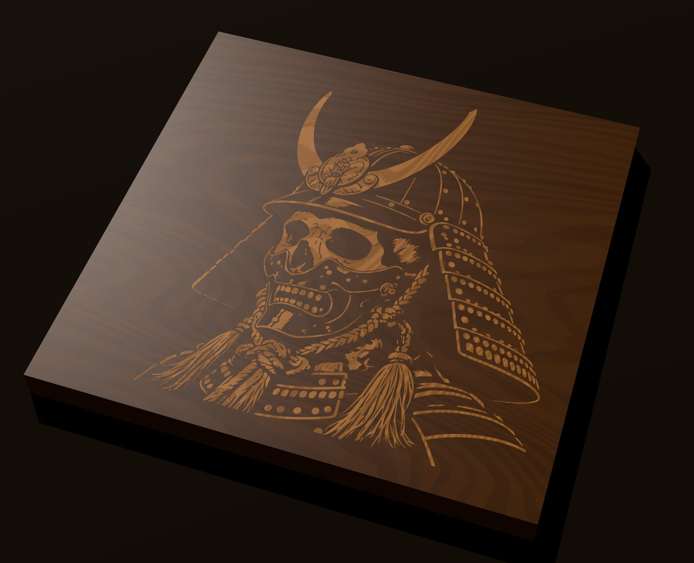</p>
<p align="center"><sub>Samurai skull sample · black walnut, oiled · elm inlay, sanded flush · Studio light</sub></p>

## Works with photo-to-cnc-svg

Carve Sim is the preview half of a pair. [photo-to-cnc-svg](https://github.com/SnazzyGaz/photo-to-cnc-svg) is an agent skill that turns a photo into bold black-and-white art and then into a CNC-ready SVG, at real size in mm with a `vcarve` layer and CNC metadata. Carve Sim opens those SVGs and shows the carve in different woods and fills before you cut. The bundled samples were made with it.

## Gallery

All rendered in Carve Sim from the bundled samples (300 mm, 60° V-bit, 3 mm deep). Same file, different board and fill.

<table>
<tr>
<td width="33%">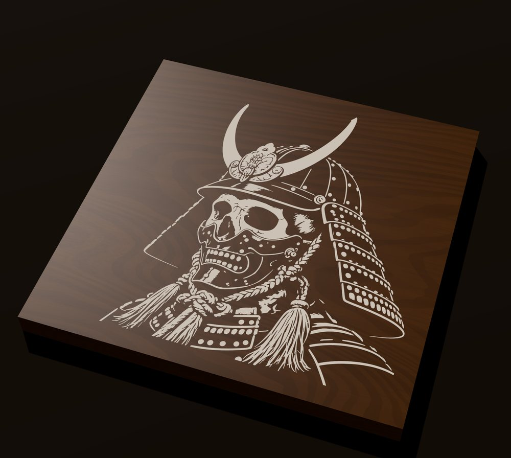<br><sub>Walnut · white epoxy, sanded</sub></td>
<td width="33%">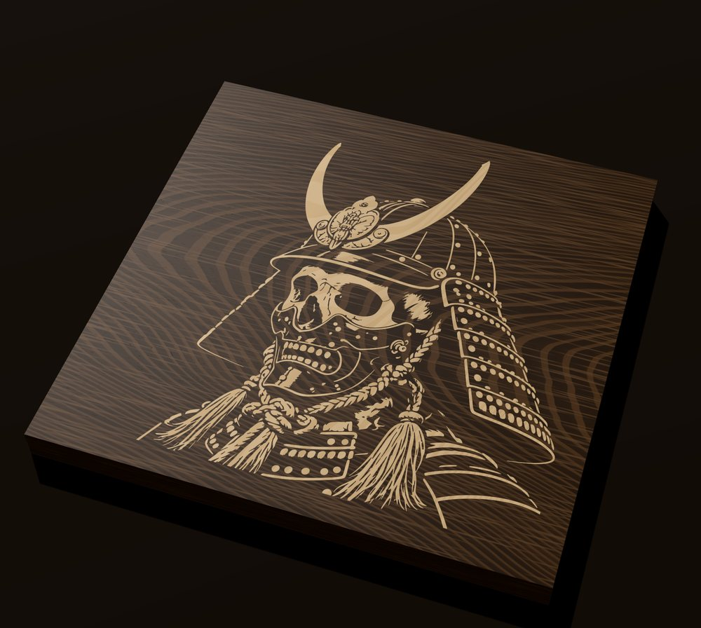<br><sub>Wenge · hard maple inlay</sub></td>
<td width="33%">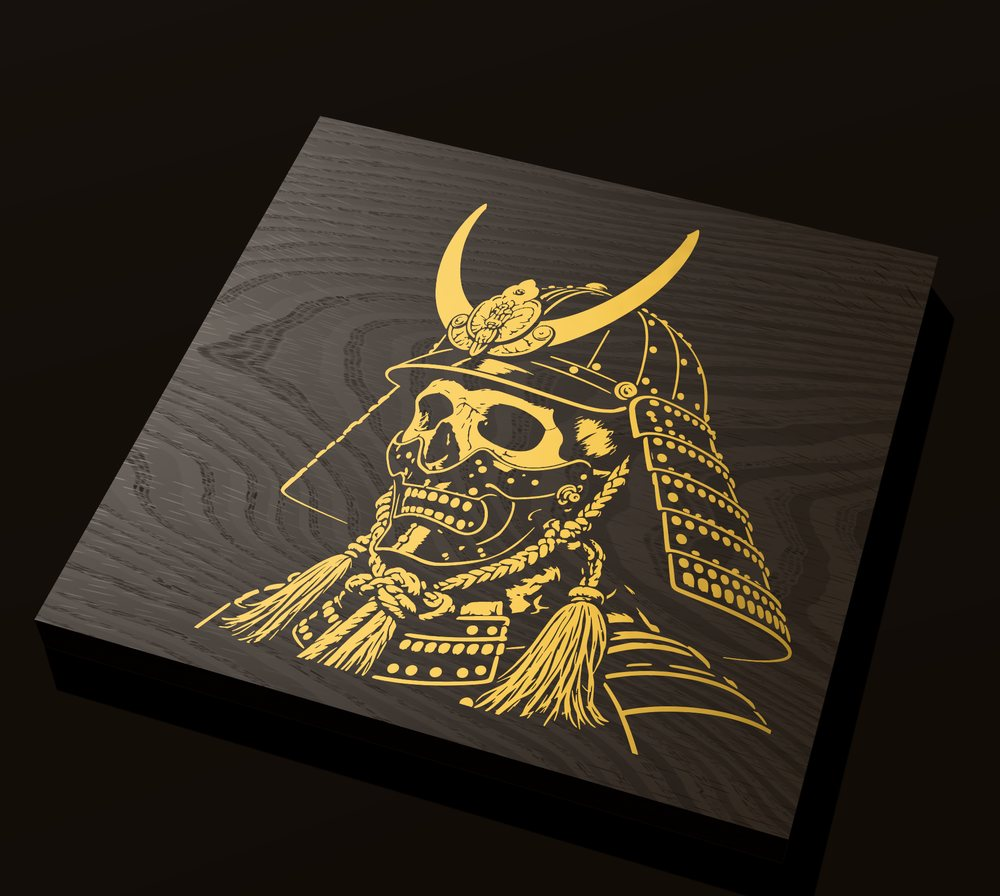<br><sub>Bog oak · brass metallic epoxy</sub></td>
</tr>
<tr>
<td width="33%">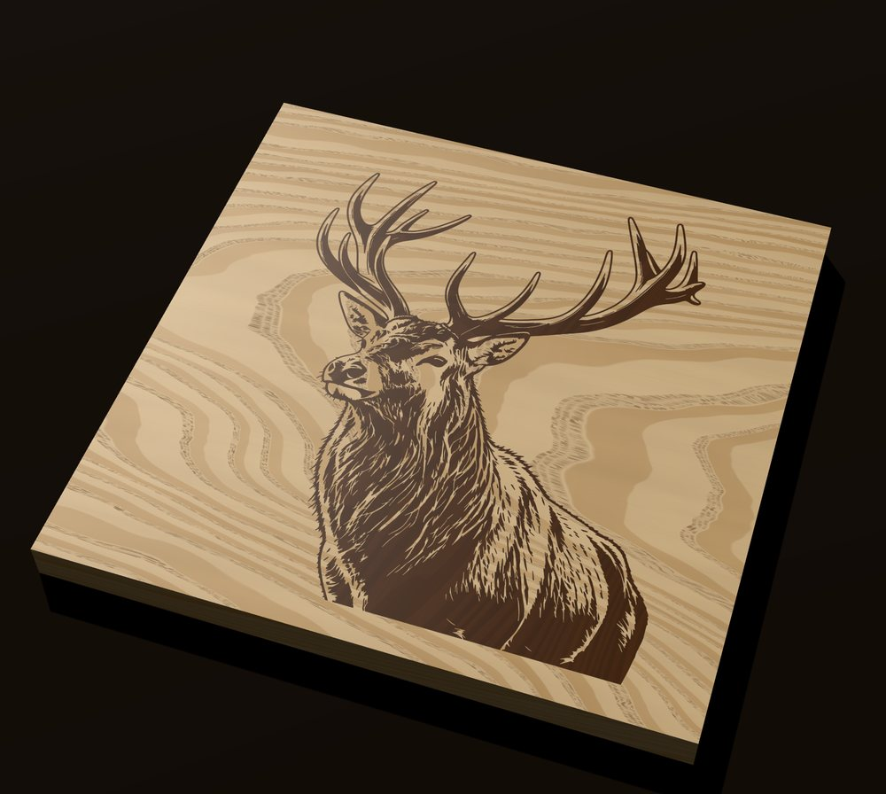<br><sub>Regal stag · ash · walnut inlay</sub></td>
<td width="33%">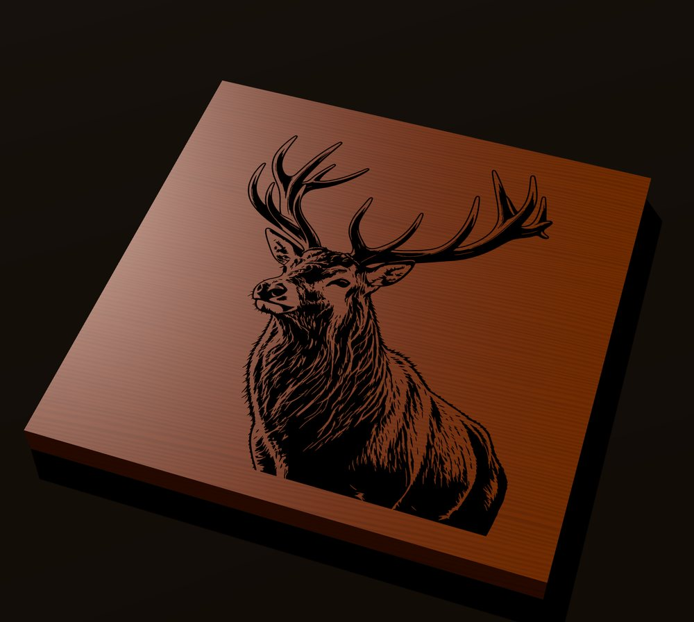<br><sub>Regal stag · cherry · black epoxy</sub></td>
<td width="33%">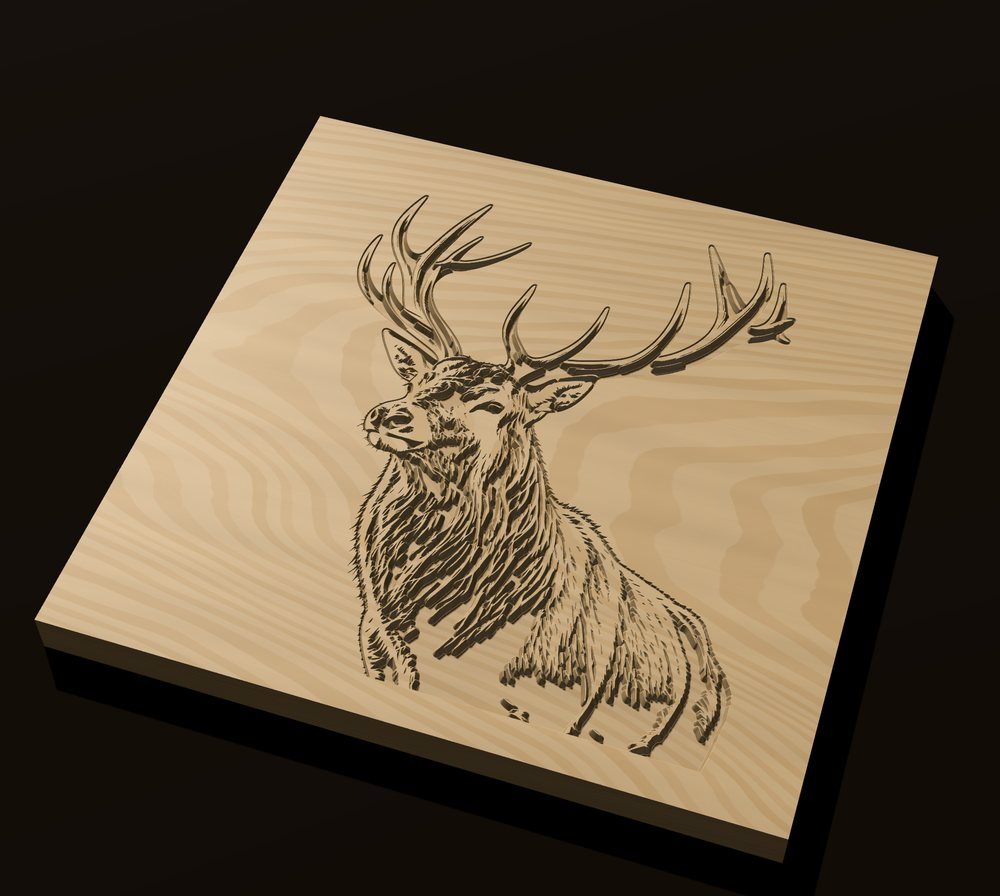<br><sub>Regal stag · hard maple, no fill · Raking light</sub></td>
</tr>
<tr>
<td width="33%">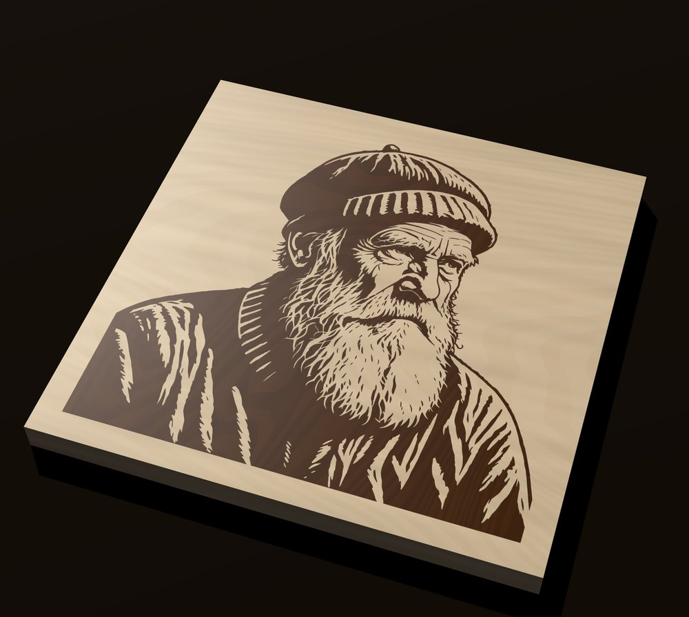<br><sub>Old fisherman · sycamore · walnut inlay</sub></td>
<td width="33%">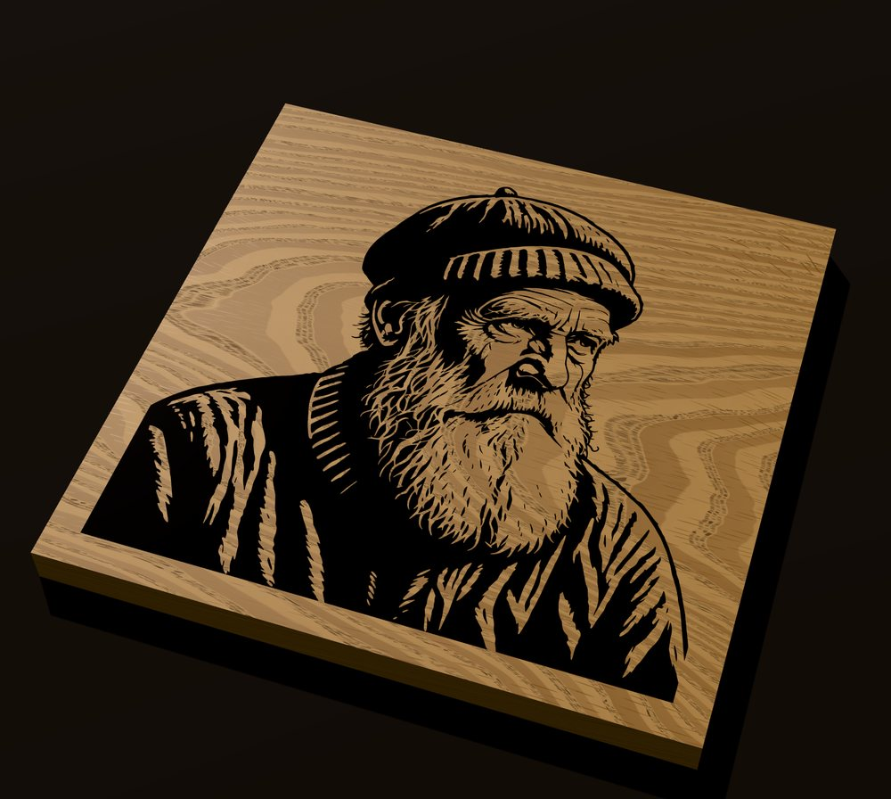<br><sub>Old fisherman · white oak · black epoxy · Daylight</sub></td>
<td width="33%">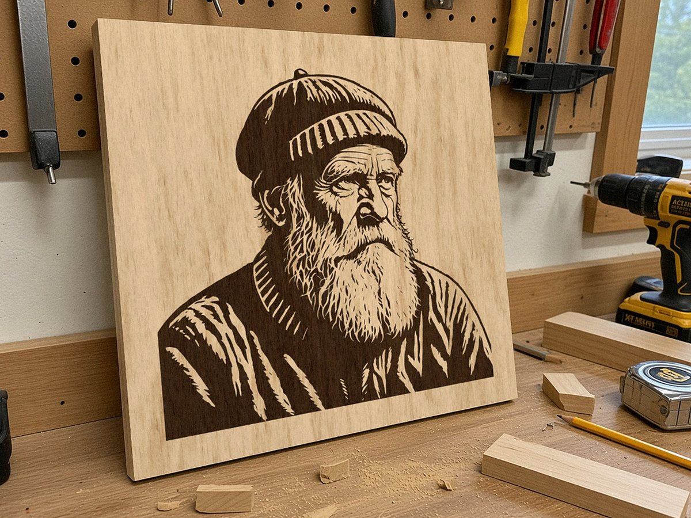<br><sub>Mock-up: a generated workshop photo with the real trace laid in, ash and walnut</sub></td>
</tr>
</table>

**Raking light shows the depth.** Close-up of the skull in walnut with no fill: the V-bit walls, the flat floors where wide areas bottom out at 3 mm, and the fine cord and rivet detail.

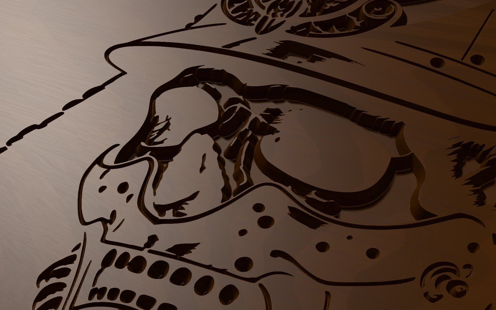

The samurai skull is an inverted design: the light parts of the art are cut and filled, so it reads as a pale image on a dark board. It opens on walnut with white epoxy.

## What it does

- **Reads the carve from the SVG.** V-carve, pockets, stepped pocket levels and engrave lines, at the file's real size, bit angle and depths.
- **Shows it in real materials.** Seventeen woods (pale, mid, dark and red, grouped by tone, including birch plywood with its plies showing in the cut) plus MDF, raw or oiled. Fills: paint in the carve with the face masked, epoxy in suggested colours or any colour you pick (opaque, metallic or tinted), a wood inlay, or a reverse inlay (the design stays board wood, the background is the other wood). Epoxy and inlays can be shown sanded flush or as poured.
- **Lights it for judging the carve.** Studio, Raking (shows depth and wall quality), Overhead and Daylight presets, with direction and brightness controls.
- **Lets you compare.** Preset camera views, a slow turntable, and A/B looks to flip between two material choices.
- **Exports a PNG** of the view, up to 4× resolution.
- **Traces an image if you have no SVG.** A clean black-and-white PNG or JPG can be traced into a CNC SVG in a side panel. It loads only when opened.

Everything runs in your browser and nothing is uploaded. It works offline once it has loaded.

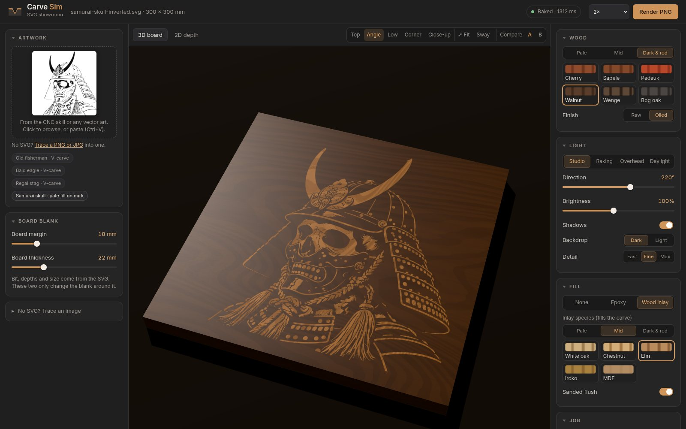
<p><sub>The app: samples and artwork on the left, the board in the middle, wood, light and fill on the right.</sub></p>

## Run it

Serve the `app/` folder with any static server, then open the page:

```
cd app && python3 -m http.server 8766    # http://127.0.0.1:8766/
```

It won't work from a double-clicked `file://`. There is no build step: `app/` is the site.

**Tests and publishing:** `python3 tools/smoke.py` (with the server above running; needs `pip install playwright && playwright install chromium`) loads every sample and every SVG in `tests/fixtures/` headless and checks each carve. GitHub Actions runs it on every push; when it passes on `main`, `pages.yml` copies `app/` to the `gh-pages` branch, which is what the website serves. Bump the cache name in `app/sw.js` when you change a sample or vendor file, or returning visitors keep the old copy.

## Desktop apps

Carve Sim also comes as an installable app for Windows, macOS and Linux. It's the same app, running offline in its own window.

**Download:** [Releases](https://github.com/SnazzyGaz/carve-sim/releases). Pick the file for your system:

- **Windows:** `Carve.Sim_x.y.z_x64-setup.exe` (or the `.msi`).
- **macOS:** `Carve.Sim_x.y.z_universal.dmg` (Apple Silicon and Intel).
- **Linux:** `Carve.Sim_x.y.z_amd64.AppImage` (run `chmod +x` on it, then open it) or the `.deb`.

The apps are **not code-signed**, so the first launch needs one extra click:

- **Windows:** SmartScreen says "Windows protected your PC". Click **More info**, then **Run anyway**.
- **macOS:** right-click the app and choose **Open**, then **Open** again. Or try to open it once, then go to **System Settings > Privacy & Security** and click **Open Anyway**.

The desktop shell is [Tauri v2](https://v2.tauri.app/) in `src-tauri/`. It loads `app/` unchanged. GitHub Actions (`.github/workflows/desktop.yml`) builds all three and attaches them to a draft release whenever a `v*` tag is pushed. To build one locally: install Rust and the [Tauri prerequisites](https://v2.tauri.app/start/prerequisites/), then run `npm ci && npx tauri build`.

## Licence

© 2026 Garyck Arntzen ([@_mintydoge](https://x.com/_mintydoge)). GPL-2.0-or-later, because the tracer uses potrace. three.js is MIT and OpenCV.js is Apache-2.0. More detail is in `docs/`.
