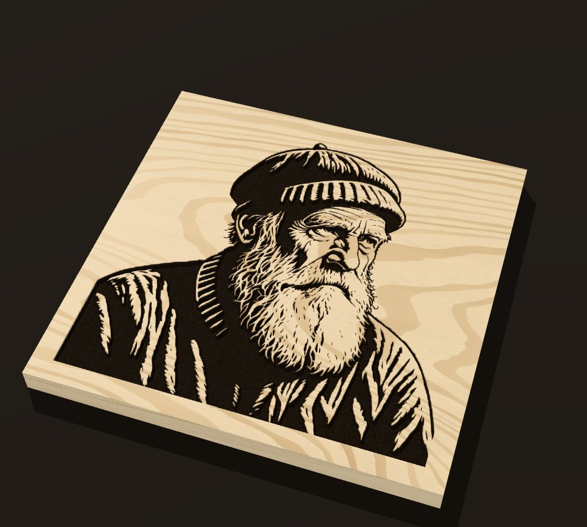

# Carve Sim · SVG showroom

A browser showroom for CNC carvings. Drop in a finished SVG (ideally one made by the CNC vector skill) and see it carved in 3D, so you can pick the wood, fill and finish before you cut anything.

**[Open Carve Sim →](https://snazzygaz.github.io/carve-sim/)**



## Works with photo-to-cnc-svg

Carve Sim is the preview half of a pair. [photo-to-cnc-svg](https://github.com/SnazzyGaz/photo-to-cnc-svg) is an agent skill that turns a photo into bold black-and-white art and then into a CNC-ready SVG, at real size in mm with a `vcarve` layer and CNC metadata. Carve Sim opens those SVGs and shows the carve in different woods and fills before you cut. The bundled samples were made with it.

## What it does

- **Reads the carve from the SVG.** V-carve, pockets, stepped pocket levels and engrave lines, at the file's real size, bit angle and depths.
- **Shows it in real materials.** Sixteen woods (pale, mid, dark and red, grouped by tone) plus MDF, raw or oiled. Fills: epoxy in suggested colours or any colour you pick (opaque, metallic or tinted), or a wood inlay. Fills can be shown sanded flush or as poured.
- **Lights it for judging the carve.** Studio, Raking (shows depth and wall quality), Overhead and Daylight presets, with direction and brightness controls.
- **Lets you compare.** Preset camera views, a slow turntable, and A/B looks to flip between two material choices.
- **Exports a PNG** of the view, up to 4× resolution.
- **Traces an image if you have no SVG.** A clean black-and-white PNG or JPG can be traced into a CNC SVG in a side panel. It loads only when opened.

Everything runs in your browser and nothing is uploaded. It works offline once it has loaded.

## Run it

Serve the `app/` folder with any static server, then open the page:

```
cd app && python3 -m http.server 8766    # http://127.0.0.1:8766/
```

It won't work from a double-clicked `file://`. GitHub Pages publishes `app/` as is, with no build step.

## Desktop apps

Carve Sim also comes as an installable app for Windows, macOS and Linux. It's the same app, running offline in its own window.

**Download:** [Releases](https://github.com/SnazzyGaz/carve-sim/releases). Pick the file for your system:

- **Windows:** `Carve.Sim_x.y.z_x64-setup.exe` (or the `.msi`).
- **macOS:** `Carve.Sim_x.y.z_universal.dmg` (Apple Silicon and Intel).
- **Linux:** `Carve.Sim_x.y.z_amd64.AppImage` (run `chmod +x` on it, then open it) or the `.deb`.

The apps are **not code-signed**, so the first launch needs one extra click:

- **Windows:** SmartScreen says "Windows protected your PC". Click **More info**, then **Run anyway**.
- **macOS:** right-click the app and choose **Open**, then **Open** again. Or try to open it once, then go to **System Settings > Privacy & Security** and click **Open Anyway**.

The desktop shell is [Tauri v2](https://v2.tauri.app/) in `src-tauri/`. It loads `app/` unchanged. GitHub Actions (`.github/workflows/desktop.yml`) builds all three and attaches them to a draft release whenever a `v*` tag is pushed. To build one locally: install Rust and the [Tauri prerequisites](https://v2.tauri.app/start/prerequisites/), then run `npm ci && npx tauri build`.

## Licence

GPL-2.0-or-later, because the tracer uses potrace. three.js is MIT and OpenCV.js is Apache-2.0. More detail is in `docs/`.
