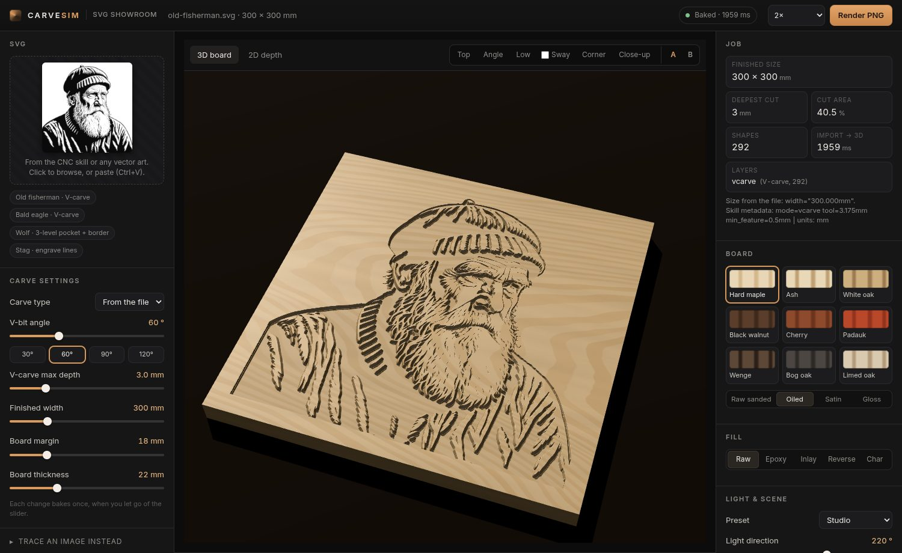

# SVG showroom

Carve Sim is now a showroom for finished SVGs, such as the ones the CNC vector skill (`cnc_vector.py`) produces. You import an SVG and it shows you how the carve will look in real wood, finishes and fills. The image-to-SVG tracer is still there, as a collapsed side panel ("Trace an image instead").

## Flow

1. **Import.** Use the drop zone, the file picker, or paste (Ctrl+V with SVG text or an .svg file). Bundled samples are in the list below the drop zone. The first visit opens the old fisherman sample (add `?nosample` to skip it).
2. **Parse** (main thread, `js/svg-import.js`). This reads the physical size, the layers and the metadata, and turns every shape into path data plus its transform.
3. **Bake** (worker, `js/svg-worker.js` + `js/sdf-lib.js`). Each layer becomes an **exact signed distance field computed from the path geometry**, not from a rasterised mask:
   - The path data is parsed (M L H V C S Q T A Z, relative and implicit commands), transformed to texture space and flattened adaptively (curves within 0.05 texel, arcs per SVG F.6.5).
   - Inside/outside is a scanline even-odd (or nonzero) test at each texel centre. The distance is the exact point-to-segment distance: seeded within 1.5 texels of every segment, then spread with two raster sweeps that keep the nearest *segment* (not the nearest pixel), so it stays exact to a few hundredths of a texel (a test circle measures 0.047 texel max error). The 60k-segment fisherman takes about 0.4 s at 2048².
   - The viewer gets one RGBA half-float texture, linearly filtered: **r** = signed mm to the cut line (+ inside), **g** = a soft mask (AO, fill), **b** = floor depth, **a** = wall slope. Depth is then rebuilt per pixel on the GPU as `clamp(sdf × slope, 0, floor)`:
     - **V-carve**: slope `1/tan(angle/2)`, floor = max depth, so `depth = min(max depth, sdf / tan(angle/2))`.
     - **Pocket**: floor = pocket depth, with a wall half a texel wide (a vertical wall, exact to the path).
     - **Pocket levels** (`pocket_level_1..N`): the levels are nested, so level 1 is the base pocket and levels 2..N each add a step of `pocket depth / N` from their own outline's distance, kept in a second RG/RGBA half texture (up to 5 levels; more are merged into the last step).
     - **Engrave**: the centreline distance gives the V of the groove (`engrave depth − dist / tan(angle/2)`).
   - Generic artwork (drawn by the browser, see below) gets a signed distance from a 2× supersampled mask instead.
   - In the shader, the board/fill boundary is the SDF's zero line with `fwidth` anti-aliasing, the normals are analytic from the SDF gradient, and grid vertices within 1.5 grid steps of a wall's lip or foot slide along the gradient onto that contour, so the displaced mesh puts an edge exactly on the cut line instead of stair-stepping at the grid spacing. (While dragging, the draft mesh uses a coarser grid.)
   - Known approximations: overlapping layers combine by taking the larger distance; two closed subpaths that abut exactly within one layer show a hairline seam.
4. **3D.** This is the materials-v2 viewer, unchanged: species, finishes, fills, lighting, the Forge orbit and sway, and the A/B look compare.

**The carve comes from the SVG, not from the showroom.** The bit and the SVG are tied: once the file is made for its bit, the showroom only shows the look. So there are no carve-type, bit, depth or width controls on import. Everything is read from the file's layers, size and metadata, and the Job panel lists it under *Carve, as read from the SVG*, marking each value "(from file)" or "(default, not in file)" for any value the file doesn't give (60° V-bit, 3 mm V-carve limit, 6 mm pocket, 1 mm engrave). Only the board blank stays adjustable, because it's cosmetic: margin and thickness rebuild the board, with no re-bake.

## How SVGs are interpreted

| What | Rule |
|---|---|
| Size | `width`/`height` in mm, cm, in, pt or pc set the board's art width. A px or unitless size has no physical meaning, so it falls back to **300 mm** wide (aspect taken from the viewBox). The Job panel shows where the size came from. |
| CNC file? | A file counts as CNC output if it has a known layer id, or a `CNC vector` comment, or if every shape has `fill="none"` (outline-style output). |
| Layer ids (on `<g>`; `inkscape:label` or `data-layer` also work, case-insensitive) | `vcarve*` → V-carve · `pocket*` → pocket · `pocket_level_N` → stepped pocket level N of the highest N · `engrave*` / `centerline` → engrave groove along the stroke · `profile*` / `cutout` / `border` → the board's cut-out line (it is not carved, and the margin goes to 0) |
| Shapes | path, rect, circle, ellipse, polygon, polyline and line, including nested transforms. Anything inside defs, clipPath, mask, symbol, pattern or marker is ignored. |
| Fill vs stroke | In CNC layers, each closed path is a region filled with the even-odd rule, so the skill's outer and inner contours make holes. Engrave layers use the stroke centreline, rasterised at 1.2 px. |
| Unlabelled outline groups | These take the file's `mode=` (pocket, engrave or vcarve). With no mode, they are V-carved. |
| Metadata | Read from the `CNC vector` comment or `<metadata>`: `mode=`, `tool=…mm`, `min_feature=`, `depth=`, `vbit=`/`angle=`. Root attributes also work: `data-mode`, `data-depth`, `data-pocket-depth`, `data-engrave-depth`, `data-vbit-angle`. `depth=` is the depth for the file's mode (pocket depth for `mode=pocket`, engrave depth for `mode=engrave`). Missing values use fixed defaults (60° bit, 3 mm V-carve limit, 6 mm pocket, 1 mm engrave), shown as defaults in the Job panel. |
| Generic artwork (filled shapes, no CNC layers, e.g. a logo from Illustrator) | The browser draws it once at the bake size, and anything darker than mid-grey is cut. That way CSS, text, gradients and knock-outs all come out as drawn. It is V-carved, or pocketed when the file says `mode=pocket` / `data-mode="pocket"`. |

## Trace an image instead

This is the old OpenCV + potrace engine (`engine.js` / `carve-worker.js`), unchanged, in a collapsed `
` panel. Its code (`trace-panel.js`, the engine, the worker and the 12 MB OpenCV wasm) loads only the first time you open the panel. It is now a one-off bake rather than live sliders:

- Choose an image type (Clean line art / Bold stencil / Photo / Fine detail), V-carve or pocket, and Invert.
- Set the job: **V-bit angle** (with 30/60/90/120° chips) and **V-carve max depth**, or **Pocket depth** for a pocket, and the **Finished width**. These are one-off inputs, used only when you press Trace.
- Press **Trace**. It runs once in the worker. The width sets the SVG's physical `width`/`height` in mm, and the bit and depth are written onto the skill's metadata line, for example `<!-- CNC vector | mode=vcarve tool=3.175mm min_feature=0.5mm depth=4mm vbit_angle=90 | units: mm -->`. The SVG then goes into the normal showroom import, which reads those values back like any other file (the Job panel shows them as "from file").
- **Download SVG** saves that same SVG, metadata included.

## Offline

Every dependency is self-hosted in `app/vendor` (three-lite, opencv.js and opencv.wasm, potrace), there are no web fonts, and nothing is fetched from a CDN. A small service worker (`sw.js`) works like this:

- On install, it precaches the app shell and the sample SVGs (about 0.5 MB gzipped, plus three-lite).
- It caches everything else the first time it is fetched, including the tracer and OpenCV once the panel has been opened.
- Code is network-first, so updates show up straight away when you are online. vendor/ and samples/ are cache-first.
- Add `?nosw` to bypass the service worker.

To test it, load the page, open the tracer once, set the context offline and reload. The page, all three samples (old fisherman, bald eagle, regal stag) and a full trace still work (tested with Playwright and `context.set_offline(true)`).

## Exports

- **PNG** (header): renders the current view at 1–4× the canvas size. It is clamped to the GPU's max renderbuffer size and 16384 px.
- **Download SVG** (trace panel): the traced SVG.
